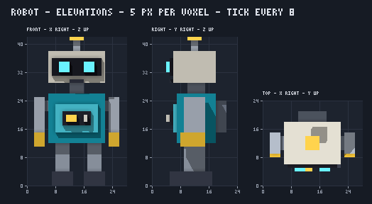

# voxel-script

Small JavaScript recipes → `.vox` models → CPU-rendered PNG previews. No npm dependencies, AI API, GPU, browser or server required. Needs **Node.js 22.2 or newer** (`node:zlib.crc32`).

Extracted from the **Power Defense authoring tools**, with three new standalone demos: lantern, mushroom and robot. This repository includes the voxel utilities, not the game engine or its full model/asset library.

**[Browse the diorama gallery](https://davidfregoli.github.io/voxel-script/)**: twelve larger scenes built with these tools, shown in an interactive WebGL viewer. It is published from the `gh-pages` branch as exported `.vox` files; the viewer and the scene recipes are not part of `main`.


## Fresh-clone quickstart

```sh
git clone https://github.com/davidfregoli/voxel-script.git
cd voxel-script
node --test
node gen.mjs
node view.mjs
```

No install step. `gen` writes `build/lantern.vox`, `mushroom.vox`, `robot.vox` and `palette.png` (256×1 RGBA). Each `.vox` embeds its own palette. `view` reads those actual files; it does not call the recipe functions or substitute the current source palette.

Open `build/views/contact-sheet.png` and `build/views/size-sheet.png` in an image viewer. Each model also gets four 192×192 isometric PNGs (`front-right`, `back-right`, `back-left`, `front-left`), `<model>-sheet.png` with those four on one image, a native 64×64 game view and a 128×128 UI view. The size sheet includes a nearest-neighbour 3× enlargement of the 64px view beside the native sizes. These are suggested inspection sizes, not an engine integration.

```sh
# Iterate on one recipe; replacing an existing model requires --force.
node gen.mjs robot --force
node view.mjs robot                              # then open build/views/robot-sheet.png

# Find where something is, look inside, look closer. See "Render, look, fix".
node view.mjs robot --elevations                 # front, right and top views with voxel rulers
node view.mjs robot --clip y:..11                # cut the model open
node view.mjs robot --focus 14,5,18 --zoom 4     # close-up of one voxel's surroundings

# Select several models, or use a separate output directory.
node gen.mjs lantern mushroom --out build/experiment
node view.mjs --input build/experiment --out build/experiment/views

# Regenerate and inspect everything after editing recipes or palette colours.
node gen.mjs --force
node view.mjs
```

`gen` checks all selected model paths before writing and refuses to overwrite any existing `.vox` without `--force`, including a model you edited elsewhere. An existing identical palette PNG is reused; a different one also requires `--force`. `view` replaces preview PNGs and never writes `.vox` files. The contact and size sheets cover the whole input directory, so only a run with no model names writes them; `node view.mjs robot` updates the robot's own previews and leaves the two shared sheets alone. Paths are relative to the current working directory. Both commands have `--help`.

If npm is installed, `npm test`, `npm run gen`, `npm run view` and `npm run demo` are convenience scripts. `demo` is the fresh-generation sequence and will refuse to overwrite existing models. `private: true` in `package.json` prevents accidental npm publication; the GitHub repository is public.

## Author a shape in code

The shape DSL is ordinary JavaScript. For example, this recipe makes a pedestal with a spherical top, cuts a recess into the front and places two coloured markers in it:

```js
import { Model } from './model.mjs'
import { R, G } from './palette.mjs'

export function beacon() {
  const m = new Model(24, 24, 28)
  m.box(4, 4, 0, 19, 19, 3, R.steel[4])
    .cylZ(12, 12, 4, 4, 13, R.cyan[4])
    .shape((px, py, pz) =>
      (px - 12) ** 2 + (py - 12) ** 2 + (pz - 19) ** 2 <= 8 ** 2,
    R.hazard[5])
    .box(8, 3, 17, 15, 7, 21, 0) // clear a recess facing -Y
    .box(9, 8, 18, 10, 8, 20, G.cyan)
    .box(13, 8, 18, 14, 8, 20, G.cyan)
  return m
}
```

Add `beacon()` to `models.mjs` (reuse its existing imports), and add `beacon` to the exported `recipes` object. Then run `node gen.mjs beacon` and `node view.mjs beacon`. After edits, regenerate with `node gen.mjs beacon --force`. Look at the image before deciding whether it resembles the intended object.

A recipe is any function that returns a `Model`, so a larger project can keep each one in its own file and import them into `models.mjs`; `gen` only reads the `recipes` object.

Useful operations:

| API | Meaning |
| --- | --- |
| `set(x,y,z,c)`, `get(x,y,z)` | Set/get an integer grid cell; `0` is empty. |
| `box(x0,y0,z0,x1,y1,z1,c)` | Fill **inclusive** integer corners, in either order. |
| `shape(test,c)` | Visit every voxel; predicate receives `(px,py,pz,x,y,z)`. |
| `ellipsoid(cx,cy,cz,rx,ry,rz,c,keep?)` | Centre-tested ellipsoid; optional `keep(x,y,z)` filter. |
| `cylX`, `cylY`, `cylZ` | Axis-aligned cylinders; axial voxel endpoints are inclusive. See recipes for argument order. |
| `tube(x0,y0,z0,x1,y1,z1,r,c)` | Capsule of radius `r` between two points, for branches, cables, pipes and limbs off the axes. The end points are positions, so the centre line of voxel column `x` is `x + 0.5`. |
| `place(model,cx,cy,z0,turns?)` | Stamp another model into this one. See the placement note under Coordinates. |
| `paint(fn)` | Recolour filled cells; return `undefined` to keep a cell or `0` to clear it. |
| `mirrorX()`, `mirrorY()` | Copy the low half onto the high half, including empty cells; preserve an odd middle plane. |
| `top(x,y)`, `front(x,z)` | Highest filled Z / first filled Y, or `-1`. |
| `open(x,y,z,dx,dy,dz)` | Whether the neighbouring cell is empty. |

A colour argument can be an index or `(x,y,z,prev) => index`, where `prev` is the index already in that voxel. Returning `prev` leaves the voxel as it was. Three **write filters** build on that and wrap any colour, with every shape:

| Filter | Meaning |
| --- | --- |
| `ifEmpty(c)` from `model.mjs` | Fill only empty voxels, so a later shape cannot overwrite what is already there. |
| `ifFilled(c)` from `model.mjs` | Recolour only filled voxels, so a shape paints a region without adding to it. |
| `darker(n)` from `palette.mjs` | Step what is already there `n` shades down its own ramp. Glow and empty voxels are left alone. |

For example `m.box(0, 0, 0, 23, 23, 5, ifEmpty(R.stone[3]))` lays a stone slab without overwriting anything already built in that space, and `m.box(4, 4, 8, 19, 19, 8, ifFilled(darker(1)))` draws a dark band around whatever crosses `z = 8`.

`hash`, `valueNoise`, `shade` and `stripes` in `model.mjs` help with deterministic variation. Keep fine noise restrained: it can obscure a small silhouette.

## Paint onto a curved surface

A window, door, stripe or emblem on a round or tapered wall is awkward to place by coordinates: a voxel set one cell too deep is buried inside the wall and never seen. `surface.mjs` scans for the surface instead.

```js
import { Model } from './model.mjs'
import { R, G } from './palette.mjs'
import { decal } from './surface.mjs'

export function silo() {
  const m = new Model(24, 24, 28)
  m.cylZ(12, 12, 9, 0, 25, R.bone[4])
  // A lit window three wide and four tall on the curved front, sunk one voxel into the wall.
  const cells = decal(m, '+y', 11, 14, 13, 17, G.amber, { inset: 1 })
  if (cells !== 12) throw new Error(`the silo window covered ${cells} cells, not 12`)
  return m
}
```

| API | Meaning |
| --- | --- |
| `firstHit(m,dir,a,b,from?,to?)` | The first filled voxel met when travelling along `dir`, as `[x,y,z]`, or `null`. |
| `decal(m,dir,a0,b0,a1,b1,paint,{from,to,inset})` | Recolour the first hit of every cell in an inclusive rectangle. Returns how many cells it painted. |
| `exposed(m,x,y,z,below?)` | Whether a voxel has an empty neighbour. Pass `below = false` to ignore the underside, for moss, snow or dust. |

- `dir` is the **direction of travel**, one of `'+x' '-x' '+y' '-y' '+z' '-z'`. `'+y'` starts at the front and looks at the front face; `'-z'` starts above and looks down. `(a, b)` are the other two coordinates in x, y, z order: `(x, z)` for a y scan, `(y, z)` for an x scan, `(x, y)` for a z scan.
- `from` and `to` limit the scan along its axis, inclusive, in either order. Use them to skip something standing in front of the wall, or to reach an inner wall.
- `paint` is an index or `(a, b, x, y, z, prev) => index`. Returning `undefined` skips that cell, which is how a round or outlined pattern is drawn inside the rectangle.
- `inset: N` removes N voxels along the scan, starting with the hit, then writes the colour into the next cell **whether or not that cell was filled**. A pane with `inset: 1` sits one voxel behind the wall face. On a wall thinner than N the colour lands in the space behind it. Colour `0` removes N + 1 voxels, so a cut-out exactly N deep is `inset: N - 1` with colour `0`.
- **Check the count.** A rectangle that faces nothing returns `0`, which is a valid result, so a decal that misses is silent unless the recipe compares the count with what the pattern should cover, as above. A malformed call throws instead: a direction other than the six strings, a non-integer coordinate, or an `inset` that is not a whole number of 0 or more.

## Coordinates and palette

- **Z is up; the front faces −Y**, towards `y = 0`. Positive X is right in the front view. The renderer's azimuth 0 looks from −Y, and azimuth 90 looks from +X. The four isometric views use azimuths 45, 135, 225 and 315 degrees at about 35.264 degrees elevation.
- Grid cell `(x,y,z)` occupies `[x,x+1] × [y,y+1] × [z,z+1]`. Shape predicates test **voxel centres**, `(x+0.5,y+0.5,z+0.5)`; colour callbacks receive integer indices. Sub-voxel features can therefore disappear.
- Dimensions are integers in `1..256`. Indices must be integers; out-of-bounds reads return zero and writes are **clipped**. Overlapping shapes replace earlier cells. **Colour zero clears** cells; it is not a black material.
- `scene.place(model, cx, cy, z0, turns)` stamps a model into a scene using the model's **centred XY, bottom pivot** `(sx/2, sy/2, 0)`. Build a repeated part once as its own small `Model` and place it several times. The free function `place(scene, model, cx, cy, z0, turns)` in `model.mjs` does the same for plain `{ sx, sy, sz, v }` grids such as a decoded `.vox` model; `render.mjs` still exports it too. `turns` is an integer number of quarter turns counter-clockwise when seen from +Z; negative turns work. Use integer `z0`. Placement floors XY cell centres onto the destination grid and clips at its edges. Empty source cells do not erase the scene. This placement convention is not pivot metadata in the `.vox` file.
- `R.<ramp>[0..7]` gives palette indices ordered **dark → light**. The ramps are `ink`, `steel`, `stone`, `sand`, `moss`, `rust`, `hazard`, `orange`, `cyan`, `violet`, `lime`, `red`, `cobalt`, `bone`, `slate` and `mauve`. These are base colours, not baked lighting.
- `G.cyan`, `G.amber`, `G.magenta`, `G.lime`, `G.red`, `G.white` and `G.orange` occupy **249..255**. The preview draws these indices unlit, and `gen` exports them as emissive materials. Index **0 is empty**.
- Indices **129..248** are free: fifteen rows for ramps of your own. `extendPalette([[name, 'eight rrggbb colours, dark to light'], ...])` in `palette.mjs` registers them as `R.<name>[0..7]` without editing the built-in table. `palettes/cozy.mjs` is an optional preset of eight warm and pastel ramps (`sakura`, `sky`, `cream`, `wood`, `teal`, `terracotta`, `mint`, `butter`) for scenes the mostly industrial built-in ramps do not suit: `extendPalette(cozy)`.
- Rows are handed out in the order they are registered, and a recipe stores indices, not names. Register every extra ramp in **one module that all recipes import**, add new ramps after the existing ones, and never reorder or remove one: a ramp that moves recolours every model that uses it.
- `PALETTE` is 1024 RGBA bytes. For a non-empty colour index, its byte offset is **`4 * (index - 1)`**. PNG pixel zero therefore represents palette index 1, not empty index 0. The final RGBA entry is unused by model cells.

Edit `palette.mjs` and regenerate to change colours. The generated palette PNG is an export, not a source file that `gen` reads back. A `.vox` file retains its embedded palette until regenerated or explicitly changed with `setVoxPalette(buffer, palette)` from `vox.mjs`. Regenerating only one recipe does not repalette existing models, so after changing a colour or adding a ramp run `node gen.mjs --force` with no model names. Every file in `build/` then embeds the same palette and matches what a fresh full run produces, byte for byte.

## Render, look, fix

1. Write a recipe around a clear silhouette and a few large features.
2. Generate the `.vox`, then run `view` to inspect what was actually exported.
3. Check all four directions for misplaced parts, blocked openings and accidental asymmetry. `<model>-sheet.png` has the four on one image. Check the **native 64px and 128px images**, not only a large render or an enlarged sheet.
4. When something is wrong, find out **where** before editing: see the inspection views below.
5. Change proportions, simplify noisy colours or move a feature; regenerate with `--force` and inspect again. Use version control for source changes and copy aside any externally edited model before replacing it.

This loop works for humans and for vision-capable agents that can open the PNGs. A procedural DSL makes operations explicit and reproducible; it **does not guarantee AI spatial reasoning or a readable design**. Text-only confidence in coordinates is not visual verification. These demos are small examples, not evidence that arbitrary prompts become production-ready art.


### Inspection views

An isometric view shows that something is wrong but not which voxel it is. These `view` options answer that. The first adds a file to a normal run; the other three write only their own file and replace no normal preview.

| Option | Writes | Use it to |
| --- | --- | --- |
| `--elevations` | `<model>-elevations.png` | Read a coordinate. Front, right and top views are drawn at a whole number of pixels per voxel with a ruler tick every 8 voxels, so the `(x, y, z)` of a defect can be read off the image and typed into the recipe. |
| `--clip z:28` | `<model>-sheet-clip-z0-28.png` | Look inside. Keeps `z <= 28`; `y:10..` keeps `y >= 10`; `x:8..40` keeps a range. Repeat the option for more axes. With `--elevations` the cut elevations are written too. |
| `--focus 14,5,18` | `<model>-sheet-focus-14-5-18-zoom-3.png` | Look closer. Centres the four isometric views on that voxel, three times closer than the view that fits the model. |
| `--zoom 4` | `<model>-sheet-zoom-4.png` | Magnify the four views 1 to 16 times, about the focus if there is one. |

`--size 320` changes the size of each isometric view (64..512, default 192). The options combine: `node view.mjs robot --clip y:..11 --focus 14,8,18 --zoom 4` is a close-up of the inside. Each tile on a sheet has a small x/y/z compass, so a direction seen in the image can be named. In the elevations, front shows +X right and +Z up, right shows +Y right and +Z up, and top shows +X right and +Y up.



A typical correction: the sheet shows a marker in the wrong place; `--elevations` shows it at `x = 16`, `z = 18` in the front view; the recipe is edited by those numbers, not by guessing from the isometric view. For anything with a hollow interior, `--clip` is the only way to see it.

The renderer traces orthographic rays through voxels on the **CPU**, with directional sun shadows, three-neighbour ambient occlusion and linear-space lighting. Glow indices keep their base colour: **they do not cast light**, add bloom or illuminate neighbouring voxels. There is an optional ground checker; `render(..., { ..., ground: false })` produces transparent backgrounds. No GPU or AI service is used.

These previews are separate from real engine rendering. An importer may use different lighting, scale, materials, camera, shadows or palette conventions. The shared `.vox` bytes guarantee only that geometry and palette match, so inspect in the destination renderer too.

`gen` marks the glow indices 249..255 as emissive materials (`MATL` chunks after the palette; see `emissive` in `vox.mjs`). MagicaVoxel 0.99.7.2 shows them as Emit materials; other importers have not been checked, and one that ignores materials sees ordinary colours. The preview still recognises glow by index and does not read the chunks. `encodeVox(model, palette)` with no third argument writes none.

## Files and limits

- `model.mjs`: voxel builder, mirrors, surface queries, sub-model placement, write filters and deterministic colour helpers.
- `surface.mjs`: scans for the surface facing a direction, to paint patterns that follow a curved wall.
- `palette.mjs`: shared ramps and glow indices; original tool colours with generic ramp names. Also `extendPalette` and the `darker` filter.
- `palettes/cozy.mjs`: optional preset of eight extra ramps.
- `vox.mjs`: minimal **single-model** version-150 `.vox` writer (`MAIN`, `SIZE`, `XYZI`, `RGBA`, optional `MATL`), raw-grid reader and palette replacement helper.
- `png.mjs`: minimal PNG codec for authored files, 8-bit RGB/RGBA, non-interlaced. Encoder writes RGBA; decoder supports PNG row filters 0..4. This is not a general image library or a hardened parser for untrusted files.
- `render.mjs`: CPU preview, axis-aligned elevations, grid clipping, image composition and small bitmap labels.
- `models.mjs`, `gen.mjs`, `view.mjs`: new demo recipes and standalone commands.
- `test/`: Node tests for formats, materials and palettes, PNG filters, clearing/mirroring, placement, write filters, surface helpers, preview output, elevations and the CLI.
- `docs/`: PNGs generated from the three new exported demos; `build/` is ignored.

The `.vox` reader returns model grids but does not interpret scene graphs, transforms, layers, cameras or materials. `view` accepts one grid with an embedded RGBA palette per file and rejects multi-model files or missing palettes. The codecs target files authored by these tools; they are not full MagicaVoxel or PNG implementations. There is **no rigging, baked motion, animation, mesh or glTF export**.

The supplied source extraction had no license file, and local projects use different licenses. No new license terms have been added here; an explicit license choice remains with the owner.
