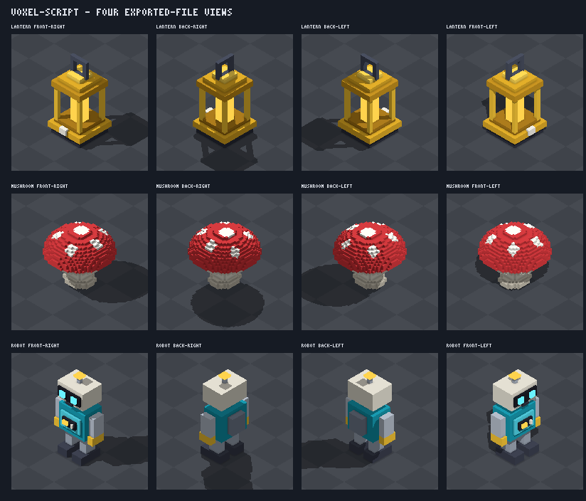
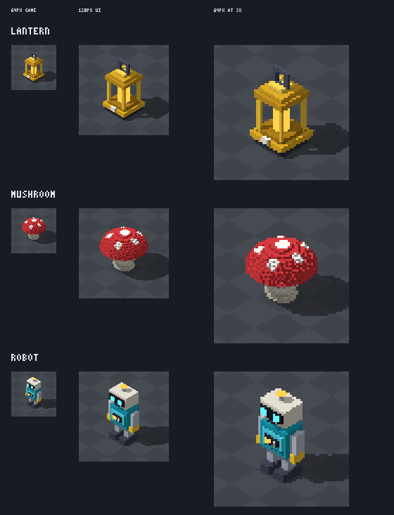

# voxel-script

Small JavaScript recipes → `.vox` models → CPU-rendered PNG previews. No npm dependencies, AI API, GPU, browser or server required. Needs **Node.js 22.2 or newer** (`node:zlib.crc32`).

Extracted from the **Power Defense authoring tools**, with three new standalone demos: lantern, mushroom and robot. This repository includes the voxel utilities, not the game engine or its full model/asset library.



## Fresh-clone quickstart

```sh
git clone https://github.com/davidfregoli/voxel-script.git
cd voxel-script
node --test
node gen.mjs
node view.mjs
```

No install step. `gen` writes `build/lantern.vox`, `mushroom.vox`, `robot.vox` and `palette.png` (256×1 RGBA). Each `.vox` embeds its own palette. `view` reads those actual files; it does not call the recipe functions or substitute the current source palette.

Open `build/views/contact-sheet.png` and `build/views/size-sheet.png` in an image viewer. Each model also gets four 192×192 isometric PNGs (`front-right`, `back-right`, `back-left`, `front-left`), a native 64×64 game view and a 128×128 UI view. The size sheet includes a nearest-neighbour 3× enlargement of the 64px view beside the native sizes. These are suggested inspection sizes, not an engine integration.

```sh
# Iterate on one recipe; replacing an existing model requires --force.
node gen.mjs robot --force
node view.mjs robot

# Select several models, or use a separate output directory.
node gen.mjs lantern mushroom --out build/experiment
node view.mjs --input build/experiment --out build/experiment/views

# Regenerate and inspect everything after editing recipes or palette colours.
node gen.mjs --force
node view.mjs
```

`gen` checks all selected model paths before writing and refuses to overwrite any existing `.vox` without `--force`, including a model you edited elsewhere. An existing identical palette PNG is reused; a different one also requires `--force`. `view` replaces preview PNGs and never writes `.vox` files. Paths are relative to the current working directory. Both commands have `--help`.

If npm is installed, `npm test`, `npm run gen`, `npm run view` and `npm run demo` are convenience scripts. `demo` is the fresh-generation sequence and will refuse to overwrite existing models. `private: true` in `package.json` prevents accidental npm publication; the GitHub repository is public.

## Author a shape in code

The shape DSL is ordinary JavaScript. For example, this recipe makes a pedestal with a spherical top, cuts a recess into the front and places two coloured markers in it:

```js
import { Model } from './model.mjs'
import { R, G } from './palette.mjs'

export function beacon() {
  const m = new Model(24, 24, 28)
  m.box(4, 4, 0, 19, 19, 3, R.steel[4])
    .cylZ(12, 12, 4, 4, 13, R.cyan[4])
    .shape((px, py, pz) =>
      (px - 12) ** 2 + (py - 12) ** 2 + (pz - 19) ** 2 <= 8 ** 2,
    R.hazard[5])
    .box(8, 3, 17, 15, 7, 21, 0) // clear a recess facing -Y
    .box(9, 8, 18, 10, 8, 20, G.cyan)
    .box(13, 8, 18, 14, 8, 20, G.cyan)
  return m
}
```

Add `beacon()` to `models.mjs` (reuse its existing imports), and add `beacon` to the exported `recipes` object. Then run `node gen.mjs beacon` and `node view.mjs beacon`. After edits, regenerate with `node gen.mjs beacon --force`. Look at the image before deciding whether it resembles the intended object.

Useful operations:

| API | Meaning |
| --- | --- |
| `set(x,y,z,c)`, `get(x,y,z)` | Set/get an integer grid cell; `0` is empty. |
| `box(x0,y0,z0,x1,y1,z1,c)` | Fill **inclusive** integer corners, in either order. |
| `shape(test,c)` | Visit every voxel; predicate receives `(px,py,pz,x,y,z)`. |
| `ellipsoid(cx,cy,cz,rx,ry,rz,c,keep?)` | Centre-tested ellipsoid; optional `keep(x,y,z)` filter. |
| `cylX`, `cylY`, `cylZ` | Axis-aligned cylinders; axial voxel endpoints are inclusive. See recipes for argument order. |
| `paint(fn)` | Recolour filled cells; return `undefined` to keep a cell or `0` to clear it. |
| `mirrorX()`, `mirrorY()` | Copy the low half onto the high half, including empty cells; preserve an odd middle plane. |
| `top(x,y)`, `front(x,z)` | Highest filled Z / first filled Y, or `-1`. |
| `open(x,y,z,dx,dy,dz)` | Whether the neighbouring cell is empty. |

A colour argument can be an index or `(x,y,z) => index`. `hash`, `valueNoise`, `shade` and `stripes` in `model.mjs` help with deterministic variation. Keep fine noise restrained: it can obscure a small silhouette.

## Coordinates and palette

- **Z is up; the front faces −Y**, towards `y = 0`. Positive X is right in the front view. The renderer's azimuth 0 looks from −Y, and azimuth 90 looks from +X. The four isometric views use azimuths 45, 135, 225 and 315 degrees at about 35.264 degrees elevation.
- Grid cell `(x,y,z)` occupies `[x,x+1] × [y,y+1] × [z,z+1]`. Shape predicates test **voxel centres**, `(x+0.5,y+0.5,z+0.5)`; colour callbacks receive integer indices. Sub-voxel features can therefore disappear.
- Dimensions are integers in `1..256`. Indices must be integers; out-of-bounds reads return zero and writes are **clipped**. Overlapping shapes replace earlier cells. **Colour zero clears** cells; it is not a black material.
- `place(scene, model, cx, cy, z0, turns)` in `render.mjs` stamps a grid using its **centred XY, bottom pivot** `(sx/2, sy/2, 0)`. `turns` is an integer number of quarter turns counter-clockwise when seen from +Z; negative turns work. Use integer `z0`. Placement floors XY cell centres onto the destination grid and clips at its edges. Empty source cells do not erase the scene. This placement convention is not pivot metadata in the `.vox` file.
- `R.<ramp>[0..7]` gives palette indices ordered **dark → light**. The ramps are `ink`, `steel`, `stone`, `sand`, `moss`, `rust`, `hazard`, `orange`, `cyan`, `violet`, `lime`, `red`, `cobalt`, `bone`, `slate` and `mauve`. These are base colours, not baked lighting.
- `G.cyan`, `G.amber`, `G.magenta`, `G.lime`, `G.red`, `G.white` and `G.orange` occupy **249..255**. The preview draws these indices unlit. Index **0 is empty**. Indices 129..248 are currently unused black entries.
- `PALETTE` is 1024 RGBA bytes. For a non-empty colour index, its byte offset is **`4 * (index - 1)`**. PNG pixel zero therefore represents palette index 1, not empty index 0. The final RGBA entry is unused by model cells.

Edit `palette.mjs` and regenerate to change colours. The generated palette PNG is an export, not a source file that `gen` reads back. A `.vox` file retains its embedded palette until regenerated or explicitly changed with `setVoxPalette(buffer, palette)` from `vox.mjs`. Regenerating only one recipe does not repalette existing models.

## Render, look, fix

1. Write a recipe around a clear silhouette and a few large features.
2. Generate the `.vox`, then run `view` to inspect what was actually exported.
3. Check all four directions for misplaced parts, blocked openings and accidental asymmetry. Check the **native 64px and 128px images**, not only a large render or an enlarged sheet.
4. Change proportions, simplify noisy colours or move a feature; regenerate with `--force` and inspect again. Use version control for source changes and copy aside any externally edited model before replacing it.

This loop works for humans and for vision-capable agents that can open the PNGs. A procedural DSL makes operations explicit and reproducible; it **does not guarantee AI spatial reasoning or a readable design**. Text-only confidence in coordinates is not visual verification. These demos are small examples, not evidence that arbitrary prompts become production-ready art.



The renderer traces orthographic rays through voxels on the **CPU**, with directional sun shadows, three-neighbour ambient occlusion and linear-space lighting. Glow indices keep their base colour: **they do not cast light**, add bloom or illuminate neighbouring voxels. There is an optional ground checker; `render(..., { ..., ground: false })` produces transparent backgrounds. No GPU or AI service is used.

These previews are separate from real engine rendering. An importer may use different lighting, scale, materials, camera, shadows or palette conventions. Inspect in the destination renderer too. The writer exports no emission material metadata; glow recognition is a convention of this preview code.

## Files and limits

- `model.mjs`: voxel builder, mirrors, surface queries and deterministic colour helpers.
- `palette.mjs`: shared ramps and glow indices; original tool colours with generic ramp names.
- `vox.mjs`: minimal **single-model** version-150 `.vox` writer (`MAIN`, `SIZE`, `XYZI`, `RGBA`), raw-grid reader and palette replacement helper.
- `png.mjs`: minimal PNG codec for authored files, 8-bit RGB/RGBA, non-interlaced. Encoder writes RGBA; decoder supports PNG row filters 0..4. This is not a general image library or a hardened parser for untrusted files.
- `render.mjs`: CPU preview, image composition, small bitmap labels and rotated grid placement.
- `models.mjs`, `gen.mjs`, `view.mjs`: new demo recipes and standalone commands.
- `test/`: Node tests for formats/palettes, PNG filters, clearing/mirroring, rotated placement, preview output and CLI overwrite protection.
- `docs/`: PNGs generated from the three new exported demos; `build/` is ignored.

The `.vox` reader returns model grids but does not interpret scene graphs, transforms, layers, cameras or materials. `view` accepts one grid with an embedded RGBA palette per file and rejects multi-model files or missing palettes. The codecs target files authored by these tools; they are not full MagicaVoxel or PNG implementations. There is **no rigging, baked motion, animation, mesh or glTF export**.

The supplied source extraction had no license file, and local projects use different licenses. No new license terms have been added here; an explicit license choice remains with the owner.
